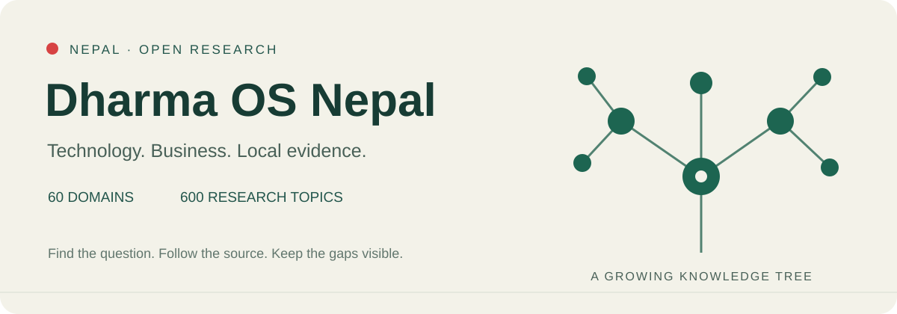

# Dharma OS Nepal



[](https://github.com/Aryalmilan-max/dharma-os-nepal/actions/workflows/checks.yml)
[](LICENSE)
[](skills/dharma-os/scripts/nepal.py)

**Turn a Nepal technology question into a study with traceable evidence.**

Explore the knowledge tree, inspect a worked study, create a research protocol, attach evidence and export a reviewable result. Built for students, technology businesses and independent researchers working on Nepal.

**New in 0.3:** complete an organization assessment from findings through an owned action queue and a printable decision report. Record what the evidence establishes, what remains unknown, who acts next and how acceptance will be demonstrated. No automated readiness/compliance score is invented.

**नेपालको प्रविधि व्यवसाय बुझ्न—तथ्याङ्क, बजार, जनशक्ति, इन्जिनियरिङ र स्थानीय प्रमाणलाई जोड्ने खुला अनुसन्धान ढाँचा।**

[Worked studies](docs/studies/qr-growth.md) · [Workbench guide](skills/dharma-os/references/nepal-tech-intelligence/workbench.md) · [Explore all 60 domains](skills/dharma-os/references/nepal-tech-intelligence/INDEX.md) · [Coverage limits](docs/coverage-and-limitations.md)

## Start without the command line

Download this repository using GitHub's **Code → Download ZIP**, extract it, and open **`web/index.html`** in a modern browser. The workspace works offline without an account, API key, installation or server.

- **Explore:** search 60 domains and their research leaves, including selected Nepali search aliases.
- **Evidence:** inspect 50 selected payment observations and annotated source records; download CSV or a source citation.
- **Worked studies:** follow four desk studies from facts through calculations, interpretation and limitations.
- **Methods:** choose among 30 analytical methods with evidence requirements and common mistakes.
- **My study:** choose a protocol, add claims and citations, check the evidence structure, save a local draft, and export JSON/Markdown.
- **Coverage:** see which branches have selected studies and which still contain only research requirements.
- **Organizations:** build requirements for solo operators, micro/small businesses, growing organizations, large enterprises and major public institutions. Combine 12 organization types with critical-service and sensitive-data flags; export an assessment with evidence needs, deliverables and acceptance checks.
- **Assessment review:** open a generated plan, record findings/evidence, assign owners and action dates, review acceptance, and export Markdown or printable HTML. Save/load a local draft or download JSON; use **Forget saved copy** to remove the browser's saved assessment.

English/Nepali navigation labels are available; source text is not automatically translated. Drafts saved in the browser stay in that browser. Download JSON for a portable backup. The interface has no analytics, account connections, automatic source retrieval or network API requests. External source links open only when you choose them.

If your browser restricts local scripts, see the [loopback-server fallback](skills/dharma-os/references/nepal-tech-intelligence/workbench.md#start-without-an-api-key).

## Start with Python or an AI agent

```bash
gh repo clone Aryalmilan-max/dharma-os-nepal
cd dharma-os-nepal
python3 skills/dharma-os/scripts/nepal.py find smartboard
python3 skills/dharma-os/scripts/nepal.py brief --domain D39 --locality "Banganga Municipality"
python3 skills/dharma-os/scripts/research.py search स्मार्टबोर्ड
python3 skills/dharma-os/scripts/research.py report qr-growth
```

The local helper needs Python 3.10+, no extra packages, no API key and no account connection. It reads the bundled snapshot; live research requires your agent's own available tools.

## Complete a real workflow

### Finish an assessment and hand it over

Open **Organizations → Build assessment → Review findings**. Save the case reference, locality and reference period first. Select a requirement and record a finding, source/test reference, exact locator, check date and rationale. Add the responsible role and next action. Unknowns remain investigation tasks; evidence-backed gaps enter the action queue. A recorded **MET** state requires an acceptance reference and reviewer role/date.

Export a printable HTML report for an owner or reviewer, or Markdown/JSON for further work. No accounts, uploads, crawler or paid API are needed. The report contains states and evidence limits rather than an overall compliance/readiness percentage. Read the [complete workflow and evidence rules](skills/dharma-os/references/nepal-tech-intelligence/assessment-review.md).

```bash
python3 skills/dharma-os/scripts/organizations.py assess --scale micro --type repair > assessment.json
python3 skills/dharma-os/scripts/assessments.py validate assessment.json
python3 skills/dharma-os/scripts/assessments.py summary assessment.json
python3 skills/dharma-os/scripts/assessments.py report assessment.json --format html > report.html
```

Inspect the [explicitly synthetic example](examples/assessment-review/synthetic-shop.json) and [its report](examples/assessment-review/synthetic-shop-report.md): one invented failed restore becomes an owned follow-up action, while seven requirements remain unknown. This demonstrates software behavior; it is not a real shop assessment or measured customer outcome.

### Dedicated working playbooks

These provide decision steps, evidence to collect, deliverables, acceptance checks and blank working records:

| User | Playbook and templates |
| --- | --- |
| [Commercial banks](docs/packs/commercial-bank/README.md) | Service dependencies/recovery, access review, regulatory evidence and supplier/change assurance |
| [Small tech shops](docs/packs/tech-shop/README.md) | Repair custody, stock ledger, costs/quotes and warranty/support cases |
| [Schools and colleges](docs/packs/school/README.md) | Site readiness, funding stages, teacher acceptance and usage review |
| [Students and researchers](docs/packs/researcher/README.md) | Literature matrix, protocol/sampling, data dictionary and reproducibility review |

```bash
python3 skills/dharma-os/scripts/packs.py show commercial-bank
python3 skills/dharma-os/scripts/packs.py export tech-shop --out my-shop-pack
```

Exports contain the playbook, structured JSON and four header-only CSVs. Existing folders are preserved. These are authored methods to apply to actual evidence, not completed audits or invented customer examples. Bank source routes include the original NRB IT guideline and policy index; current applicability and later amendments still require qualified review.

### From small industry to major institutions

Use **Organizations** in the browser, or:

```bash
python3 skills/dharma-os/scripts/organizations.py profiles
python3 skills/dharma-os/scripts/organizations.py assess --scale micro --type manufacturing --format markdown
python3 skills/dharma-os/scripts/organizations.py assess --scale enterprise --type software --critical --sensitive-data
```

Six scale profiles combine with repair, retail/distribution, manufacturing, software/IT, education, health, finance/cooperatives, government, NGOs, hospitality, agriculture and research organizations. Sixteen requirement areas address workflow, cost, identity, backup, power/connectivity, records, training, support, procurement, integration, security/privacy, continuity, governance, delivery, people and measurement.

Each assessment starts **NOT_ASSESSED**, with evidence to collect, expected deliverables and acceptance tests. Criticality and sensitive data can deepen requirements at any size. These are authored assessment frameworks, not verified audits, legal enterprise-size definitions or proof of regulatory compliance. Nepal remains the geographic scope. Relevant professional and current regulatory evidence must be obtained for the actual organization.

**Student:** choose `student-thesis`, establish the question and sample, build a literature/evidence matrix, and export a study for supervisor review. Your institution's ethics, academic-integrity and thesis-format requirements still apply.

**Business:** choose `ict-market` or `school-readiness`, separate observed need from funding and buying intent, and identify the next evidence needed for a decision.

**Technical researcher:** choose `engineering-review`, `tender-review` or `media-verification`, trace requirements and claims to their sources, and retain contradictions and unresolved checks.

```bash
python3 skills/dharma-os/scripts/research.py init --template school-readiness --question "Is the selected school ready for a smart classroom?" --locality "Banganga Municipality" --out study.json
python3 skills/dharma-os/scripts/research.py validate study.json
python3 skills/dharma-os/scripts/research.py report study.json
```

The new file is a research plan until actual evidence is added. `init` refuses to overwrite existing work. Validation catches structural mistakes; it cannot certify that a conclusion is true, a sample is representative or a purchase is justified.

## Reproduce and challenge a finding

The [QR study](docs/studies/qr-growth.md) computes an **83.95%** increase in reported national QR transaction volume between the printed Bhadra 2082 and 2083 periods. It explicitly does not infer unique-user growth, school demand, municipal adoption or a causal effect.

```bash
python3 skills/dharma-os/scripts/research.py compare NRB-qr-volume-202509 NRB-qr-volume-202609
python3 skills/dharma-os/scripts/research.py dataset --format csv
python3 skills/dharma-os/scripts/research.py cite NP-BIZ-NRB-PAYMENTS-BHADRA2083 --format bibtex
```

Inspect the [original NRB table](https://www.nrb.org.np/psd/payment-systems-indicators-of-2083-bhadra/), its units and periods, and the [selected CSV](data/payment-observations.csv). Other worked studies examine [wallet counts](docs/studies/wallet-interpretation.md), [average QR transaction amount](docs/studies/qr-ticket.md), and [what school/procurement source routes establish](docs/studies/classroom-evidence-audit.md).

## Who this helps

- **Nepal technology founders and SMEs:** connect market questions with operating costs, skills, suppliers and institutional needs.
- **ICT suppliers and procurement researchers:** structure evidence around requirements, local context and actual procurement stages.
- **Students, analysts and contributors:** find a research question, check the source and add a useful correction or local evidence.
- **Agent builders:** reuse a portable `SKILL.md`, source registry and standard-library helper.

Dharma OS connects technology with statistics, markets, management, entrepreneurship, HR, procurement, institutions, infrastructure and the external conditions affecting business in Nepal. It is a research framework and source-discovery collection. It is not a complete market database or a running media monitor.

## What is included

| Resource | Count | Meaning |
| --- | ---: | --- |
| Knowledge domains | 60 | Organized business, technical and external-environment branches |
| Core research topics | 600 | Questions to investigate, not 600 verified findings |
| Engineering specialization topics | 164 | Finer prompts; overlap with core topics is possible |
| Analytical principles and methods | 30 | Nepal applications, evidence requirements and failure modes |
| Source records | 119 | 117 distinct URLs, with individual verification limits |
| Payment dataset | 50 | 10 selected national series × 5 printed periods; not a continuous monthly series |
| Distinct statistical measurements | 52 | Expanded dataset plus two legacy observations; eight legacy observations overlap |
| Worked desk studies | 4 | Maintainer analyses, not independent academic peer review or field studies |
| Research protocols | 6 | Students, markets, schools, tenders, engineering and media |
| Checked publisher records | 37 | Historical checks; no continuous monitoring claim |

Original source-check snapshot: **2026-11-11**. Selected NRB table rechecked: **2026-11-12**. Individual source dates still apply. Recheck current facts before consequential use. Linked studies touch seven domains; that does not establish complete coverage of those domains. See the [domain coverage ledger](data/domain-coverage.csv).

## Explore

Python 3.10 or newer is sufficient. The helper uses only the standard library, reads bundled files, and makes no network requests.

```bash
python3 skills/dharma-os/scripts/nepal.py coverage
python3 skills/dharma-os/scripts/nepal.py find smartboard
python3 skills/dharma-os/scripts/nepal.py domain D39
python3 skills/dharma-os/scripts/nepal.py sources labour
python3 skills/dharma-os/scripts/nepal.py methods sampling
python3 skills/dharma-os/scripts/nepal.py observations
python3 skills/dharma-os/scripts/nepal.py brief --domain D39 --locality "Banganga Municipality"
```

The example brief treats its locality as an unverified research target. It does not assert a budget, tender, demand or official geographic-code match.

Start with the [knowledge-tree index](skills/dharma-os/references/nepal-tech-intelligence/INDEX.md), [methodology](skills/dharma-os/references/nepal-tech-intelligence/methodology.md), and [coverage notes](docs/coverage-and-limitations.md).

## Use as an agent skill

The portable skill is in `skills/dharma-os/`. Copy that complete folder into a skill directory supported by your agent. Check for an existing `dharma-os` skill first and preserve any private customized edition. This repository does not install or overwrite skills automatically. Host-specific discovery and execution requirements should be checked in that host's documentation.

Example request:

> Use Dharma OS to investigate smart-classroom needs in this Nepal locality. Identify the relevant institutions, official sources, procurement stage, operating constraints and evidence still missing.

Skill format and CLI behavior are checked locally; behavior in every agent product has not been certified. No accounts, browser sessions, remote tools or paid APIs are bundled.

## Data, privacy and provenance

This public edition contains authored workflow material and public-source metadata. Private company references, chats, client/employee records, credentials, local runtime configuration, private databases and bulk registration extracts are excluded.

The wider research examined locality and media registers. Those raw/extracted registers and original PDFs are not distributed here. Their research counts are explicitly separated from packaged resources. Obtain source material from the original publishers and check applicable terms before redistributing it.

See [source provenance](sources/provenance.json) and [third-party notices](THIRD_PARTY_NOTICES.md). The [MIT license](LICENSE) covers the project's original code and authored prose; it does not relicense referenced third-party publications or data.

## Develop and contribute

```bash
python3 -m unittest discover -s tests -v
node tests/browser_core.cjs
node tests/assessment_core.cjs
python3 scripts/build_library.py
python3 scripts/build_packs.py
python3 scripts/build_assessment_example.py
```

Read [CONTRIBUTING.md](CONTRIBUTING.md). Useful contributions include source corrections, verified local evidence, better methods and clearer coverage limits. A new source or topic must not silently become a claim of nationwide coverage.

Python has no third-party runtime dependencies; Node.js 20+ is only needed for the browser-core development tests. CI checks Python 3.10/3.12, the browser core and deterministic generated artifacts. See the [upgrade review](docs/upgrade-review.md), [research priorities](docs/roadmap.md) and [software citation](CITATION.cff).

**Help improve one leaf:** choose a domain, contribute a public Nepal source, explain what it establishes, and retain its limitations. See [starter contributions](docs/roadmap.md). If this is useful, star the repository or share it with someone researching Nepal's technology sector.
